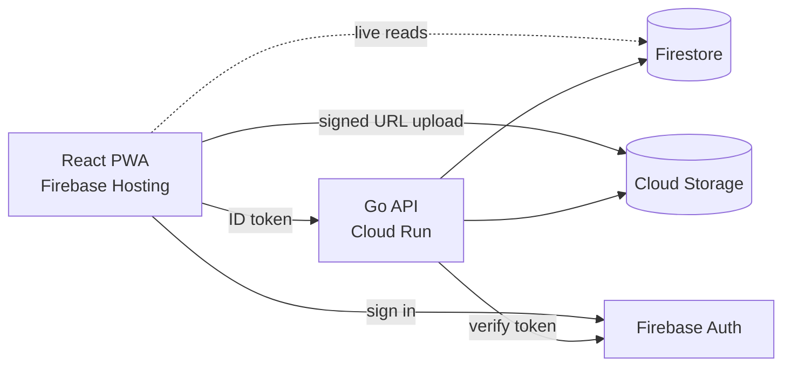
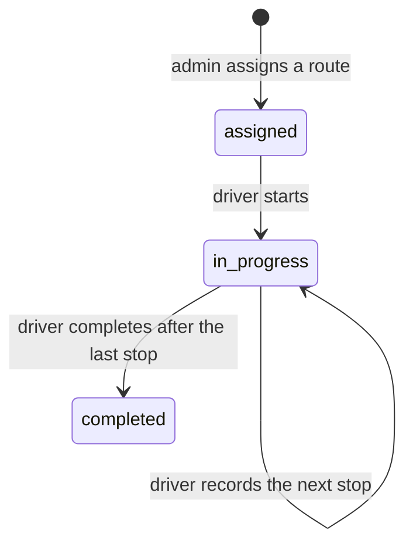

# Routekeeper

Delivery route tracking for small fleets. Admins build routes and assign daily trips. Drivers follow them on their phone and record each stop with a GPS fix and a proof photo. Admins watch progress live and export reports.

## Features

- **Roles**: superadmin, admin and driver, enforced by Firebase custom claims, the API and Firestore security rules
- **Places and routes**: warehouses, shops and home deliveries; a route is a start point, ordered stops and an end point
- **Trips**: assign a route to a driver for a day; reassign or reorder stops while the trip is unfinished
- **Verified stops**: several GPS samples are combined into one fix and matched against the stop's radius
- **Proof photos**: camera-only capture, stamped with place, time and position, uploaded straight to Cloud Storage through signed URLs
- **Live admin view**: trip map, timeline and status update in real time
- **Corrections**: admins amend an outcome without overwriting the original record
- **Reports**: CSV export by date range and driver
- **Installable PWA** with self-hosted vector maps (no map API key)

## Stack

| Layer | Technology |
|---|---|
| Web | React 19, TypeScript, Vite, Tailwind CSS 4, TanStack Query, React Router, Zod, React Hook Form, MapLibre GL + PMTiles |
| API | Go, chi, Firebase Admin SDK, Firestore, Cloud Storage |
| Infrastructure | Terraform / OpenTofu: Firebase Auth, Firestore, Cloud Storage, Artifact Registry, Cloud Run, Firebase Hosting, billing budget |



All writes go through the API. The browser only reads Firestore directly for live updates, and the security rules reject every client write.

## Repository layout

```
api/     Go API
  cmd/server     HTTP server
  cmd/seed       creates the first superadmin; optional demo places
  cmd/loadtest   read-only load generator
  internal/      auth, config, domain (pure business rules), handlers, httpx, media, store
  firestore.rules, storage.rules, firestore.indexes.json
web/     React PWA
  src/app          router and root component
  src/config       typed, validated environment
  src/components   shared UI (ui primitives, layout, map, trip, photo, stops)
  src/features     auth, account, admin/*, driver/*  (each with api.ts + hooks.ts)
  src/lib          http client, schemas, query, firebase, gps, camera, formatting
infra/   Terraform for the whole GCP/Firebase project
  bootstrap/       creates the project, links billing, creates the state bucket
```

---

## Run locally

**Requirements:** Go 1.25+, Node 22+, Docker, and a Firebase project with Email/Password sign-in enabled. Sign-in always uses real Firebase Auth; the Firestore data stays local in the emulator.

### 1. API

```bash
cd api
cp .env.example .env                # set GOOGLE_CLOUD_PROJECT to your project id
make emulator                       # Firestore emulator in Docker on :8085
export FIRESTORE_EMULATOR_HOST=localhost:8085
make run                            # API on http://localhost:8080
```

Create the first superadmin (the password is read from stdin, never from arguments) and, optionally, a few demo places:

```bash
gcloud auth application-default login
make seed-admin EMAIL=you@example.com NAME="Your Name" PHONE="+1 555 0100" GOOGLE_CLOUD_PROJECT=<project-id>
make seed-demo GOOGLE_CLOUD_PROJECT=<project-id>
```

### 2. Web

```bash
cd web
cp .env.example .env                # Firebase web config + VITE_API_BASE_URL=http://localhost:8080
npm install
npm run dev                         # http://localhost:5173
```

Find the Firebase web config under *Firebase console → Project settings → Your apps*. After a Terraform deploy, `tofu output firebase_web_config` prints the same values.

### Tests

```bash
cd api && make test-race            # unit tests with the race detector
cd api && make test-integration     # store tests against the emulator
cd web && npm test && npm run typecheck && npm run lint
cd infra && tofu init -backend=false && tofu test
```

---

## Deploy to Google Cloud

Everything runs in a GCP project you own, created and configured by Terraform. You need nothing but your own Google account and a billing account.

### Prerequisites

- [OpenTofu](https://opentofu.org) 1.8+ or Terraform 1.8+ (commands below use `tofu`; `terraform` works the same)
- [gcloud CLI](https://cloud.google.com/sdk/docs/install), [Firebase CLI](https://firebase.google.com/docs/cli), Docker, Node 22+

```bash
gcloud auth login
gcloud auth application-default login
gcloud billing accounts list          # note your billing account id
```

### 1. Bootstrap: project, billing and state bucket

```bash
cd infra/bootstrap
tofu init
tofu apply -var project_id=<project-id> -var billing_account_id=<XXXXXX-XXXXXX-XXXXXX>
```

This creates the project, links billing and creates a versioned bucket `<project-id>-tfstate` for Terraform state. Run it once.

### 2. Provision the platform

```bash
cd ..                                 # infra/
cp terraform.tfvars.example terraform.tfvars    # fill in project_id, billing_account_id, site_id
tofu init -backend-config="bucket=<project-id>-tfstate"
tofu apply
```

| File | Provisions |
|---|---|
| `apis.tf` | enables the required Google APIs |
| `firebase.tf` | Firebase project, Email/Password auth, authorized domains, Hosting site, web app |
| `firestore.tf` | Firestore database and composite indexes |
| `rules.tf` | deploys `api/firestore.rules` and `api/storage.rules` |
| `storage.tf` | private photo bucket with CORS for signed uploads and lifecycle retention |
| `run.tf` | Artifact Registry, runtime service account and IAM, Cloud Run service (scale to zero) |
| `budget.tf` | monthly billing budget with alert thresholds |
| `outputs.tf` | API URL, hosting URL, bucket, web config, image registry |

| Variable | Default | Purpose |
|---|---|---|
| `project_id` | — | GCP project id |
| `billing_account_id` | — | billing account for the budget |
| `site_id` | — | Hosting site, served at `https://<site_id>.web.app` |
| `region` | `us-central1` | region for Firestore, Storage, Cloud Run (cannot change later) |
| `custom_domains` | `[]` | extra browser origins, e.g. `["app.example.com"]` |
| `api_image` | hello image | API container image |
| `photo_retention_days` | 365 | how long proof photos are kept |
| `budget_amount` | 10 | monthly budget in the billing currency |

The first apply runs Cloud Run with a placeholder image so everything can be created in one pass.

### 3. Build and deploy the API

```bash
REPO=$(tofu output -raw artifact_registry_repo)
gcloud auth configure-docker "${REPO%%/*}"
cd ../api
make image IMAGE=$REPO/api:v1
docker push $REPO/api:v1
cd ../infra
tofu apply -var api_image=$REPO/api:v1      # or set api_image in terraform.tfvars
```

### 4. Build and deploy the web app

```bash
tofu output firebase_web_config       # copy the values into web/.env
tofu output -raw api_url              # VITE_API_BASE_URL in web/.env
cd ../web
npm ci && npm run build
firebase deploy --only hosting --project <project-id>
```

The predeploy check refuses to ship without the basemap files. To build them for your region, see **Maps** below.

### 5. Create the first superadmin

```bash
cd ../api
make seed-admin EMAIL=you@example.com NAME="Your Name" PHONE="+1 555 0100" GOOGLE_CLOUD_PROJECT=<project-id>
```

Open `https://<site_id>.web.app` and sign in. Then create admins, drivers, places and routes from the app.

### Updating

- API: build and push a new tag, then `tofu apply -var api_image=...`
- Web: `npm run build && firebase deploy --only hosting`
- Rules and indexes: edit them in `api/`, then `tofu apply`

### Teardown

```bash
cd infra && tofu destroy
```

The bootstrap project and state bucket are protected from deletion. Delete the project from the console if you want everything gone.

---

## Configuration

**`web/.env`**

| Variable | Purpose |
|---|---|
| `VITE_APP_NAME` | name shown in the UI and PWA manifest |
| `VITE_API_BASE_URL` | API base URL |
| `VITE_FIREBASE_*` | Firebase web config |
| `VITE_TIMEZONE` | IANA timezone for dates, the daily trip boundary and photo stamps |
| `VITE_MAP_CENTER` | initial map view `lng,lat` |
| `VITE_MAP_BOUNDS` | optional pan limit `minLng,minLat,maxLng,maxLat` |

**`api/.env`**: `GOOGLE_CLOUD_PROJECT`, `STORAGE_BUCKET`, `ALLOWED_ORIGINS`, `PORT`, `SIGNED_URL_TTL_SECONDS`, and `FIRESTORE_EMULATOR_HOST` for local use. In production, Terraform sets these on Cloud Run.

## Maps

Maps use a self-hosted [Protomaps](https://protomaps.com) PMTiles file, so there is no tile server or API key. Build one for your area:

```bash
cd web
pmtiles extract https://build.protomaps.com/<YYYYMMDD>.pmtiles \
  public/map/basemap.pmtiles --bbox=<minLng,minLat,maxLng,maxLat> --maxzoom=14
node scripts/make-map-style.mjs
node scripts/fetch-map-assets.mjs
```

Without a basemap, the app still works in development and draws locations on a blank canvas. Map data © OpenStreetMap contributors.

## Trip lifecycle



- A trip freezes a copy of its route when assigned, so later route edits never change trips already handed out.
- The driver is only ever given the next stop, so stops cannot be skipped.
- Recording a stop is idempotent, so a retry on a bad connection records it once.
- Stop events are append-only. A correction is a new event that changes the effective outcome; the original record stays as it was.
