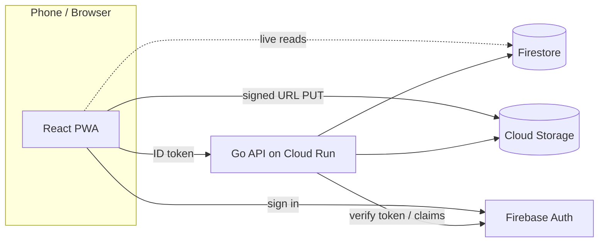

# Routekeeper

Delivery route tracking for small fleets. Admins build routes and assign daily trips; drivers follow them on their phone and record each stop with a GPS fix and a proof photo; admins watch progress live and export reports.

## Features

- **Roles**: superadmin, admin and driver, enforced by Firebase custom claims, the API and Firestore rules
- **Routes**: start point, ordered stops (registered places or home deliveries) and end point
- **Trips**: assign a route to a driver for a day, reassign or reorder stops before it is finished
- **Verified stops**: several GPS samples are combined into one fix and matched against the stop's radius
- **Proof photos**: taken in-app (camera only), stamped with place, time and position, uploaded straight to Cloud Storage with signed URLs
- **Live admin view**: trip map, timeline and status update in real time via Firestore listeners
- **Corrections and audit**: admins correct an outcome without overwriting the original record
- **Reports**: CSV export by date range and driver
- **Installable PWA** with offline-friendly self-hosted maps

## Stack

| | |
|---|---|
| Web | React 19, TypeScript, Vite, Tailwind CSS 4, TanStack Query, React Router, Zod, React Hook Form, MapLibre GL + PMTiles |
| API | Go, chi, Firebase Admin SDK, Firestore, Cloud Storage |
| Platform | Firebase Auth, Firestore, Cloud Storage, Cloud Run, Firebase Hosting |



All writes go through the API. The browser only reads Firestore directly for live updates, and the security rules make every client write fail.

## Repository

```
api/          Go API (cmd/server, cmd/seed, cmd/loadtest, internal/...)
web/          React PWA
rules-tests/  Firestore security rules tests
firebase.json Hosting, Firestore and Storage rules config
```

See [docs/architecture.md](docs/architecture.md) for the data model and trip lifecycle.

## Run locally

Requirements: Go 1.25+, Node 22+, Docker (for the Firestore emulator), a Firebase project for Auth.

```bash
# API
cd api
cp .env.example .env
make emulator                      # Firestore emulator on :8085
make run                           # API on :8080

# first superadmin (password is read from stdin)
make seed-admin EMAIL=you@example.com GOOGLE_CLOUD_PROJECT=<project-id>

# Web
cd ../web
cp .env.example .env               # Firebase web config + VITE_API_BASE_URL
npm install && npm run dev
```

## Tests

```bash
cd api && make test-race           # unit tests
cd api && make test-integration    # against the emulator
cd web && npm test                 # component and unit tests
cd rules-tests && npm test         # security rules (needs a JDK)
```

## Deploy

1. Create a Firebase project and enable Email/Password auth, Firestore and Cloud Storage. Create a bucket for photos.
2. Build and deploy the API to Cloud Run:
   ```bash
   cd api
   make image IMAGE=<region>-docker.pkg.dev/<project>/<repo>/api:latest
   docker push <image>
   gcloud run deploy api --image <image> --region <region> \
     --set-env-vars GOOGLE_CLOUD_PROJECT=<project>,STORAGE_BUCKET=<bucket>,ALLOWED_ORIGINS=https://<site>.web.app
   ```
   The runtime service account needs Firestore, Storage and `iam.serviceAccountTokenCreator` on itself (for signed URLs).
3. Set `VITE_API_BASE_URL` to the Cloud Run URL, build the web app and deploy hosting and rules:
   ```bash
   cp .firebaserc.example .firebaserc   # set your project id
   cd web && npm run build && cd ..
   firebase deploy --only hosting,firestore,storage
   ```

## License

[MIT](LICENSE)
