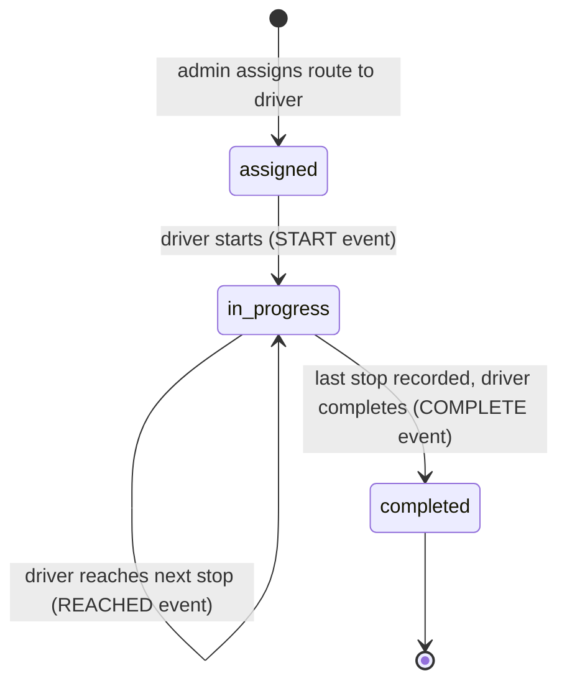

# Architecture

## Roles

| Role | Can |
|---|---|
| `superadmin` | everything an admin can, plus create and manage admins |
| `admin` | manage drivers they created, places, routes, trips, corrections, reports |
| `driver` | see and run only their own trips |

The role lives in a Firebase custom claim. The API checks it on every request (`internal/auth`, `internal/domain/roles.go`) and the Firestore rules (`api/firestore.rules`) apply the same model to the read-only live views.

## Data model (Firestore)

```
users/{uid}            name, email, phone, role, active, createdBy, photo
shops/{id}             kind (warehouse | shop | home), name, address, lat, lng, radiusM, active
routes/{id}            name, start, stops[] (ordered), end, active, version
config/app             default match radius
trips/{id}             routeId, driverUid, assignedDate, status, currentStopSeq,
                       routeSnapshot (route frozen at assign time), routeNote
trips/{id}/events/{id} START | REACHED | COMPLETE | CORRECTION  (append-only)
```

A trip copies its route into `routeSnapshot` when it is assigned, so later edits to the route never change trips already handed out. Admins can still edit the stops of an unfinished trip; the driver sees a note explaining the change.

## Trip lifecycle



- The API only ever exposes the **next** stop to the driver, so stops cannot be skipped.
- Every `REACHED` request carries an idempotency key, so a retried request on a bad connection records the stop once.
- The GPS fix is judged against the stop's radius (`matched` / `suspect`), and the server stores both the client and server time.
- A `CORRECTION` event changes the outcome or match that admins see, but the original event stays as it was.

## Photos

1. The client asks the API for a signed upload URL scoped to the trip and stop.
2. The photo is compressed and stamped on the device, then `PUT` directly to Cloud Storage.
3. The `REACHED` event records the object's generation, so a later upload cannot replace the evidence.
4. Photos are read back through the API, which checks authorization for each request. The bucket itself stays private.

## Web client

- One TanStack Query cache for server state. Each feature owns its `api.ts` and `hooks.ts`.
- `useLiveInvalidate` subscribes to a Firestore document or query and invalidates the matching queries when it changes.
- Theme tokens live in `src/index.css`. Admin and driver areas set a different accent through `data-role`.
